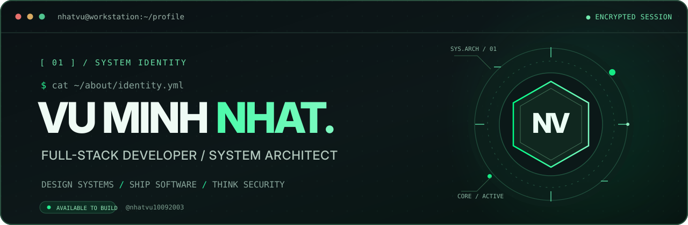
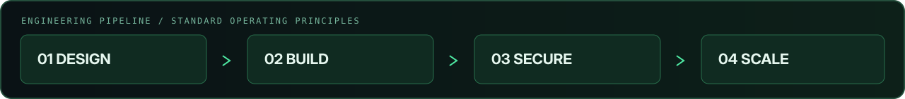

<!--
  GitHub Profile / nhatvu10092003
  Theme: Terminal / Midnight Green
  All SVG artworks are stored locally in ./assets/.
  README links & GitHub cards require internet access.
  IMPORTANT: The location below is publicly visible even inside <details>.
-->

<div align="center">



<br />

**Building secure systems. Crafting useful software. Designing for scale.**

<sub>Full-Stack Engineering &nbsp;·&nbsp; System Architecture &nbsp;·&nbsp; Desktop & Mobile &nbsp;·&nbsp; Cybersecurity</sub>

<br /><br />

<a href="https://nvsoftware.xyz"></a>
<a href="https://nvstudio.site"></a>
<a href="https://nhatvu.io.vn"></a>

</div>

---

## 01 / Identity

```bash
$ whoami
vu-minh-nhat  --role="Full-Stack Developer / System Architect"
$ cat mission.txt
"Design deliberately. Build reliably. Secure by default."
```

I design business logic, data architecture, and applications across **web, desktop, and mobile**. My interests extend from software engineering to ethical security research, network infrastructure, and self-managed hosting.

- **Current focus:** GNovel — system architecture, business workflows, and database design.
- **Learning:** Python automation and native integrations for Flutter / React Native.
- **Beyond code:** Ethical hacking, server/cPanel management, international domains, and 4K graphics workflows.
- **Based in:** Dong Nai, Vietnam.

<div align="center">
  
</div>

## 02 / Currently Building

### `~/projects/GNovel`

> **GNovel** — an application platform in active architecture and development.

| Area | Focus |
| :-- | :-- |
| `architecture/` | Modular, maintainable application structure |
| `business-logic/` | Domain rules, core workflows and integrity |
| `database/` | Data models, schema evolution and consistency |
| `security/` | Secure-by-design decisions and dependable operations |

<sub>Working philosophy: simplify complexity, optimize for maintainability, and document important decisions.</sub>

## 03 / Software Ecosystem

| Product / Platform | What it does | Link |
| :-- | :-- | :-- |
| **NV Software** | Software services and products for desktop, mobile and web | [nvsoftware.xyz](https://nvsoftware.xyz) |
| **NV Studio** | Game tools, mods, hacks and shared community resources | [nvstudio.site](https://nvstudio.site) |
| **Nhat Vu Blog** | Engineering notes, personal knowledge and practical experiences | [nhatvu.io.vn](https://nhatvu.io.vn) |

## 04 / Technology Arsenal

<div align="center">

**`WEB / BACKEND`**


**`DATA / INFRASTRUCTURE`**


**`DESKTOP / MOBILE`**


**`SECURITY / DESIGN`**


</div>

## 05 / GitHub Intelligence

<div align="center">


</div>

<sub>Statistics are loaded from independent public services and may occasionally be unavailable or cached. Language metrics reflect public repositories and may differ from personal skill levels.</sub>

## 06 / Establish Connection

<div align="center">

<a href="https://www.facebook.com/vuminhnhat10092003"></a>
<a href="https://zalo.me/0348253995"></a>
<a href="https://nhatvu.io.vn"></a>

</div>

<details>
<summary><b>Location details</b> · Dong Nai, Vietnam</summary>

> **Note:** Everything inside this section is still public on GitHub.

Tổ 7, Khu 2 An Hòa, Xã Hưng Thịnh, Thành phố Đồng Nai, Vietnam.

[View on Google Maps](https://www.google.com/maps/search/?api=1&query=T%E1%BB%95+7%2C+Khu+2+An+H%C3%B2a%2C+X%C3%A3+H%C6%B0ng+Th%E1%BB%8Bnh%2C+Th%C3%A0nh+Ph%E1%BB%91+%C4%90%E1%BB%93ng+Nai)

</details>

<div align="center">

*“The quieter you become, the more you are able to hear.”*

</div>

<br />

<div align="center">

</div>
